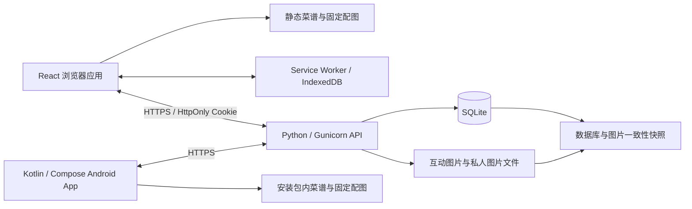

# DeepCook Web

从找到一道菜，到看懂步骤、动手烹饪，再到分享成品与保存自己的拿手菜。DeepCook 将官网、浏览器应用、原生 Android App 和云端服务连接成一套持续使用的厨房工具：固定菜谱离线可读，个人资料随账号同步，评分、评论和交作业由云端共享。

[访问官网](https://deepcook.jijiz.cn/) · [打开网页版](https://deepcook.jijiz.cn/app/) · [Android 项目](https://github.com/SakuraVillager/DeepCook) · [服务器下载 APK](https://deepcook-backend.jijiz.cn/deepcook-api/v1/downloads/DeepCook-0.6.1.apk) · [GitHub Release](https://github.com/SakuraVillager/DeepCook/releases/tag/v0.6.1)

## 项目亮点

| 设计与工程实践 | 实际实现 | 源码入口 |
| --- | --- | --- |
| 从展示到使用的完整产品路径 | 官网介绍 → 找菜与筛选 → 分步阅读 → 收藏或自建 → 评分、评论与交作业 → 账号同步 | [应用入口](src/kitchen/KitchenApp.tsx)、[Android 介绍](src/AndroidIntro.tsx) |
| Web 与 Android 共用账号和数据 | 昵称、头像、饮食偏好、收藏、最近浏览、个人菜谱及图片同步；固定菜谱沿用稳定 ID | [Web 同步](src/kitchen/account-api.ts)、[Android 云端实现](https://github.com/SakuraVillager/DeepCook/tree/dc87f6a/app/src/main/java/com/deepcook/app/data/cloud) |
| 离线阅读与云端持久化结合 | 494 道内置菜谱、806 张引用图片；Service Worker 缓存应用与菜谱，IndexedDB 保存本机状态和按账号隔离的缓存 | [内容同步工具](tools/sync-catalog.py)、[离线缓存](public/app/sw.js)、[本机存储](src/kitchen/storage.ts) |
| 面向真实网络故障的同步设计 | 保存带版本校验和操作标识，处理多设备冲突、重复请求与响应丢失；失败时保留输入和草稿 | [账号同步](src/kitchen/account-api.ts)、[互动提交](src/kitchen/useCommunity.ts)、[服务端事务](server/accounts.py) |
| 围绕做菜场景组织交互 | 详情居中阅读、桌面步骤与图片分栏、手机与 iPad 触控翻步、进度恢复和可选阅读常亮 | [阅读页](src/kitchen/Reader.tsx)、[手势处理](src/kitchen/useReaderSwipe.ts)、[详情页](src/kitchen/RecipeView.tsx) |
| 从开发延伸到部署与交付 | 多页面静态构建、轻量 API、定时备份、正式签名 APK、双下载源、SHA-256 校验和断点续传 | [构建配置](vite.config.ts)、[服务部署](server/deploy.py)、[下载服务](server/downloads.py) |

## 功能与体验路径

1. **找到今晚想做的菜。** 搜索菜名、别名与材料，多词全部匹配；分类、时间和难度可组合筛选。搜索条件与列表展开状态可恢复。
2. **看懂材料和做法。** 查看份量、材料、准备、步骤图片、观察提示、注意事项和内容来源。原文缺失的数据显示「无」，不根据步骤数猜测时间或难度。
3. **进入分步阅读。** 从任意步骤开始，通过目录、按钮或触控滑动翻步；刷新后恢复阅读进度。桌面采用左侧步骤、右侧配图，窄屏采用上下结构，阅读页不重复展示准备材料。
4. **积累自己的厨房。** 收藏支持撤销；最近浏览去重并最多保留 50 条。个人菜谱可新建、编辑、删除和上传图片，资料补全先查本地，再查固定版本的远程来源，只填空白字段。
5. **记录做菜结果。** 内置菜谱支持 1–10 分评分、评论和交作业，自己的评分可修改，自己的内容可删除。作业可附一张云端成品照；公开记录支持分页查看。
6. **跨设备继续使用。** 注册或登录后同步资料、偏好、显示与阅读设置、收藏、最近浏览及个人菜谱；可选择合并原有本机资料和已发布的访客互动。Web 与 Android 使用同一套云端账号。

账号页位于 `/app/#/login` 与 `/app/#/register`，支持直接打开、刷新和登录后返回原页面。未登录时右上角显示「注册 / 登录」，登录后显示头像和昵称。登录与注册使用独立的一屏布局，不显示网站底部栏。

## 架构与数据流



| 数据类型 | 存储与访问方式 |
| --- | --- |
| 内置菜谱、固定封面与步骤图、来源和许可 | Web 静态资源 / Android assets；正常浏览不需要将固定资源上传数据库 |
| 账号、密码哈希、会话、个人资料与同步版本 | 服务端保存；个人资料通过登录会话校验归属 |
| 收藏、最近浏览、偏好、个人菜谱 | 登录后云端持久化，客户端保留按账号隔离的缓存；游客使用本机存储 |
| 内置菜谱的评分、评论和交作业 | 云端统一维护；Web 个人菜谱互动保存在本机账号空间，Android 私有互动通过账号扩展同步 |
| 作业照、头像和个人菜谱图片 | 文件存储与数据库关联分开；已发布的作业照公开，私人图片需登录并校验归属 |
| 未发布草稿与阅读状态 | 本机保存，用于刷新恢复和失败重试；发布或云端保存需要联网 |

静态内容与动态业务分开部署，使浏览菜谱不必为每张固定图片访问数据库。后端采用单进程、多线程和 SQLite WAL，适合当前小规模单机部署；通过索引、游标分页、ETag、请求大小限制和图片压缩控制资源使用。数据库写入通过锁与事务协调，避免将多进程扩容当作默认部署方式。

Web 使用 React 19、TypeScript、Vite 多页面构建；官网动效由 GSAP / ScrollTrigger 与 Lenis 实现。Android 使用 Kotlin、Jetpack Compose、Repository 与 StateFlow，具体实现见 [Android README](https://github.com/SakuraVillager/DeepCook#readme)。

## 安全与可靠性设计

安全措施落在服务端校验、数据生命周期和发布流程中，各项均可定位到实现与回归测试。

| 关注点 | 已实现的措施 | 实现与验证 |
| --- | --- | --- |
| 密码与会话 | 独立随机盐、PBKDF2-HMAC-SHA256（600,000 次迭代）、恒定时间比较；数据库保存会话令牌哈希；退出使会话失效，改密撤销其他会话 | [accounts.py](server/accounts.py)、[账号测试](tests/test_accounts.py) |
| 浏览器认证与请求来源 | 生产会话使用 `__Host-` Cookie，设置 Secure、HttpOnly、SameSite=Lax；账号写入检查允许的 Origin；账号会话令牌不写入 localStorage | [服务端认证](server/accounts.py)、[客户端请求](src/kitchen/api.ts)、[跨来源与归属测试](tests/test_accounts.py) |
| 私有资料与内容权限 | 服务端从会话确定账号；个人资料与图片按归属读取，评论与作业只能由所有者删除；前端传入账号 ID 不能替代鉴权 | [账号接口](server/accounts.py)、[互动接口](server/community.py)、[权限测试](tests/test_community_server.py) |
| 输入与图片上传 | 校验字段、类型、长度、图片大小与尺寸；服务端解码后重新编码 JPEG，使用内容哈希命名；设置上传配额、待发布图片数量及磁盘预留 | [上传处理](server/community.py)、[私人图片处理](server/accounts.py)、[资料校验](server/account_data.py) |
| 并发与重复提交 | 参数绑定查询、事务写入、revision 冲突校验和 mutationId 去重；上传与正式发布分阶段处理，未发布作业图片不公开 | [账号事务](server/accounts.py)、[互动事务](server/community.py)、[故障恢复测试](tests/browser/account-cloud.spec.ts) |
| 资源与运行权限 | 登录及互动请求限流；专用服务用户、只读系统目录、禁止提权、内存与任务数限制；APK 下载分块读取并限制同时传输数量 | [服务单元](server/deepcook-community.service)、[下载服务](server/downloads.py)、[下载测试](tests/test_downloads.py) |
| 备份与清理 | 数据库备份配合关联图片生成一致性快照，校验数据库后标记完成；每日定时执行，保留最近 7 份完成快照，并清理过期暂存图片 | [备份实现](server/community.py)、[定时任务](server/deepcook-backup.timer)、[备份测试](tests/test_community_server.py) |
| 发布凭据与安装包 | 正式签名密钥和口令保存在仓库外；公开 Release 不嵌入开发者 AI 服务密钥；分发提供 SHA-256 校验，APK 下载不占用静态站点单文件配额 | [Android 构建配置](https://github.com/SakuraVillager/DeepCook/blob/dc87f6a/app/build.gradle.kts)、[发布元数据](src/data/app-download.ts) |

客户端遇到上传失败、存储配额不足或保存响应丢失时保留输入，用户可继续重试。损坏的本机记录保留原件并提示处理，不自动清空用户数据；旧私有互动也不会因启用云端而自动公开。

## 视觉与交互

官网以「火候」为叙事线索，使用暖米纸、灶火黄、墨黑与橄榄绿，搭配 Archivo、Instrument Serif 和 Noto Sans SC 本地字体。设计参考 `rerise.co` 的编辑式排版与滚动叙事，配色、内容与章节围绕 DeepCook 重新组织。

- 首页包含加载揭示、交叉淡入 Hero、逐字翻转链接、精选菜谱横向浏览与烹饪步骤滚动展示。第二章浏览完横向卡轨后再离场；第三章左侧文字固定，右侧菜谱在一屏窗口中滚动，结束后整屏离场。
- 中间章节通过 `DesignCanvas` 按横屏、竖屏和短屏画布统一缩放；应用内容页采用响应式网格和自然滚动，长菜谱不塞进固定比例画布。
- 官网、在线版与阅读页共用 `Header`、`Footer`、`Cursor` 和设计变量。鼠标光点快速跟随、圆环稍慢跟随；悬停交互元素时放大圆环并隐藏光点。
- 菜谱首次加载沿用首页进度与揭示语言，正常动效下至少保留 1.6 秒的可读提示；数据未就绪时继续等待，站内切页不重复播放。
- 尊重 `prefers-reduced-motion`，减少动态效果时跳过强制动画等待；提供语义化标题、图片替代文本、可见键盘焦点和进度语义。
- 手机与 iPad 的横向翻步保留纵向滚动、双指缩放和文字选择，避免阅读手势与翻页相互抢占。

APP 介绍页以找菜、分步做菜和 AI 下厨三个关键功能为主线，桌面图文左右交错，手机切换为上下结构。图片由内置 imagegen 按现有应用功能制作，页面明确标为功能预览；末尾保留原下载区。网页品牌标识与 favicon 使用 Android 厨师帽图标的原始矢量路径及配色，素材和提示词见 [APP 视觉素材说明](docs/android-visuals.md)。

相关实现位于 [画布样式](src/styles/canvas.css)、[详情样式](src/styles/recipe.css)、[阅读样式](src/styles/reader.css) 与 [触控回归](tests/browser/reader-touch.spec.ts)。

## 工程结构

```text
src/components/       官网章节与跨页面复用组件
src/kitchen/          浏览、详情、阅读、编辑、账号与同步
src/data/             官网内容与统一 APK 下载配置
src/styles/           设计变量、官网与应用样式
public/catalog/       固定菜谱、图片、来源索引与许可
public/app/sw.js      应用离线缓存
server/               账号、互动、图片、备份与下载服务
tests/                领域测试、API 测试与浏览器回归
tools/                菜谱同步与隔离测试构建工具
```

## 本地运行与构建

需要 Node.js 24+；Python 服务依赖见 [server/requirements.txt](server/requirements.txt)。

```bash
npm ci
npm run dev
```

开发服务器默认 `http://localhost:5173/`。`/`、`/android/` 和 `/app/` 为独立 Vite 多页面入口，应用内部使用 hash 路由。未配置 `VITE_COMMUNITY_API` 时使用本机模式；启用账号和云端互动需要另行运行并配置 API。该变量是公开服务地址，不是凭据，不应放入密钥。

```bash
npm run build
npm run preview
```

生产产物位于 `dist/`，`base` 为 `./`。部署时需支持目录索引，确保 `/app/` 和 `/android/` 分别返回对应 `index.html`；API 的 HTTPS 反向代理由部署者配置。

| 路径 | 用途 |
| --- | --- |
| `/` | 官网首页 |
| `/android/` | Android 功能介绍与两种 APK 下载入口 |
| `/app/` | 浏览器应用，支持内部路由直接刷新 |
| `/catalog/` | 固定菜谱、引用图片和来源许可 |
| `/download/DeepCook-0.6.1.apk` | 重定向至服务器的正式 APK 下载 |
| `/download/DeepCook-0.5.1-preview.apk` | 旧下载路径兼容跳转 |

EdgeOne 重定向在 [edgeone.json](edgeone.json) 中配置，并随构建复制到产物；本地开发与预览也提供相同的下载跳转。APK 保存在服务器和 GitHub Releases，静态站点中不包含大型安装包。

### 同步固定菜谱

```bash
python3 tools/sync-catalog.py ~/DeepCook
```

该工具只读取指定 Android 工作区，复制菜谱及其引用图片、来源清单与许可，保留原始 ID、路径和内容；不执行 fetch/pull，不修改 Android 工程，也不上传用户资料。同步后运行内容契约测试，检查 ID 唯一性与图片引用。

### 更新 APK

1. 在 Android 项目构建正式签名 Release，核验版本、签名、大小与 SHA-256；签名材料保留在仓库外。
2. 将同一安装包与校验文件发布至 GitHub Releases 和服务器下载服务。
3. 更新 [app-download.ts](src/data/app-download.ts) 与 [edgeone.json](edgeone.json)，网站各入口共用版本和地址；保留旧下载路径兼容跳转。
4. 重新构建和部署静态站点，检查两个下载源及断点续传。

当前正式包为 **0.6.1 / Android 8.0+ / 137.9 MB**。正式签名与旧调试版不同，旧用户需先同步资料，卸载旧版后安装；后续正式版本需持续使用同一发布密钥。

## 验证与质量保障

测试覆盖数据规则、服务端权限与事务、浏览器使用路径三层。失败、重试和多设备情形有独立用例，测试构建与线上写入隔离。

| 测试层 | 覆盖内容 | 入口 |
| --- | --- | --- |
| 领域与内容契约 | 菜谱 ID 与引用文件、多词搜索、组合筛选、缺失数据、浏览去重、评分分档与正文约束 | [domain.test.mjs](tests/domain.test.mjs)、[community.test.mjs](tests/community.test.mjs) |
| Python API | 注册与会话、改密、账号与图片归属、访客合并、版本冲突、重试去重、限流、图片发布、备份、下载范围与并发限制 | [账号测试](tests/test_accounts.py)、[互动测试](tests/test_community_server.py)、[下载测试](tests/test_downloads.py) |
| 浏览器交互 | 搜索、收藏、编辑与草稿、触控阅读、离线重开、响应式、共享组件、动画与下载入口 | [浏览器回归](tests/browser/) |
| 本机云端联调 | 独立浏览器共享互动、跨设备资料与图片、上传失败、响应丢失、账号切换和并发恢复 | [账号联调](tests/browser/account-cloud.spec.ts)、[互动联调](tests/browser/community-cloud.spec.ts) |

最近一次 0.6.1 发布验证通过 **11 项 Web 领域测试、27 项 Python API 测试和 4 项下载页／导航／页脚浏览器回归**；下载页用例检查了 320、390、768、1024、1440 像素宽度。APK 的版本、非调试标记、正式签名和两下载源的校验值已核对，服务器下载验证了字节范围请求。APP 图文介绍与品牌更新另通过 8 项定向浏览器回归，覆盖三个功能区、响应式、导航、页脚和鼠标动效。其余浏览器与云端联调用例的执行命令见下方。

```bash
# 领域与 API
npm test
python3 -m unittest discover -s tests -p 'test_*.py' -v

# 浏览器本机模式：构建时清空生产 API，避免测试写入线上
npm run build:test
npx playwright install chromium
npm run test:e2e

# 云端联调：自动启动本机临时数据库服务
npm run build:test -- --cloud
npm run test:e2e -- --config playwright.cloud.config.ts

# 静态检查与正式构建
npm run lint
npm run build
```

Python 测试需先在虚拟环境安装服务依赖。已有 Chrome 时可通过 `CHROME_PATH=/usr/bin/google-chrome` 使用本机浏览器。云端联调需要 Python 可执行环境；测试结束后运行 `npm run build` 恢复正式 API 配置的产物。Lint 当前仍有既有 React 规则警告，构建与测试结果分别记录。

## 当前能力边界

- **Web 与 Android 按场景互补。** 网页提供找菜、阅读、个人菜谱和云端互动；App 源码包含计时、AI 厨房与语音模块。网页版尚未接入 AI 和烹饪计时，公开正式 APK 不包含开发者 AI 服务密钥，在线 AI 能力需要先配置服务。
- **营养数据采用统一估算口径。** 根据 CoFID 2021 与 USDA SR Legacy 的常用食材成分、标注用量和人数进行粗略估算；明确人数时按份折算，其余按整道菜合计。数值仅供饮食参考，未提供的值显示「—」。
- **离线能力依赖已有内容。** Web 首次访问需要联网，之后可读取缓存的菜谱文本；图片按需缓存，最多 160 个资源，未缓存图片显示占位。注册、云端写入和跨设备同步需要网络。
- **账号恢复与部署仍有扩展空间。** 当前提供用户名密码注册、登录、退出与改密，尚未启用邮箱验证和邮件找回；备份为单机快照，未配置异地容灾。服务定位为小规模单机使用，暂无高可用集群或公开压测结论。

## 内容与许可

菜谱内容来源于 HowToCook、Based Cooking 与项目自编内容；HowToCook 和 Based Cooking 使用 Unlicense，部分照片来自 FoodiesFeed（CC0 等效）。原始路径、固定来源版本与许可随内容清单保留，详情页可查看来源。首页展示菜谱步骤、AI 功能预览与营养估算卡片；实际使用入口为 `/app/`，互动记录由对应存储模式读取，前端不再注入样例评分或帖子。

[互动移植说明](docs/community-port.md) 记录最初移植时的行为与来源版本；后续账号、云端图片和同步能力以本 README 及当前源码为准。

## 营养估算口径

营养成分参考 [CoFID 2021](https://www.gov.uk/government/publications/composition-of-foods-integrated-dataset-cofid) 和 [USDA FoodData Central SR Legacy](https://fdc.nal.usda.gov/download-datasets/)，食材条目保留来源编号、单位和文件校验值。程序统一处理常用食材、克／千克／斤／两、毫升／升、用量区间及人数；按件计算时使用来源表的标准单件重量近似，体积按 1 mL≈1 g 近似。少量辅料、可选食材及区间取值记录在生成文件中。

构建工具位于 Android 项目的 `tools/build_nutrition.py`，两端共用生成的 `nutrition_estimates.json`。估算与菜谱原料、用量和人数绑定，配方变化后重新生成；显示时校验配方一致性。页面提示「营养数据为大致估算，仅供饮食参考」，未提供的数值统一显示「—」。

发布文案逐项调整见 [发布文案清单](docs/release-copy-audit.md)。
